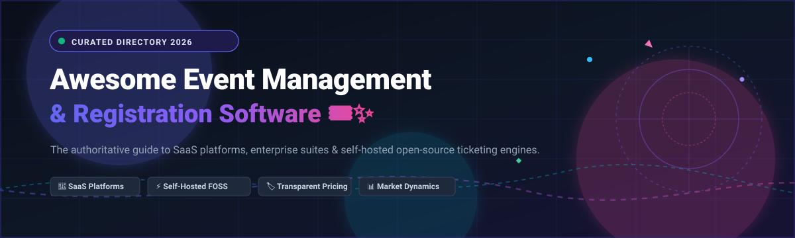
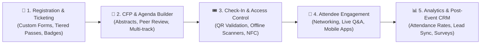

# 🎪 Awesome Event Management & Registration Software 🎟️✨

> **A curated, SEO-optimized directory of top Event Management, Ticketing, and Registration platforms — featuring enterprise SaaS systems with transparent pricing and self-hosted open-source conference and meetup alternatives.** 🚀📅
>
> 🌟 **Star this repository to stay up-to-date with emerging event technologies, open-source ticketing tools, and industry trends!** 🌟

---

## 📑 Table of Contents

- [🌐 Sector Overview & Market Dynamics](#-sector-overview--market-dynamics)
- [🏢 SaaS & Hosted Commercial Platforms](#-saas--hosted-commercial-platforms)
  - [📊 SaaS Platforms Comparison Matrix](#-saas-platforms-comparison-matrix)
  - [🔍 Detailed SaaS Platform Breakdown](#-detailed-saas-platform-breakdown)
- [🔓 Open-Source Software & Self-Hosted Solutions](#-open-source-software--self-hosted-solutions)
  - [⭐ Open-Source Repositories Ranked by Stars](#-open-source-repositories-ranked-by-stars)
  - [🛠️ Detailed Open-Source Project Breakdown](#-detailed-open-source-project-breakdown)
- [⚖️ Feature Comparison at a Glance](#-feature-comparison-at-a-glance)
- [🚀 Key Event Platform Architectural Capabilities](#-key-event-platform-architectural-capabilities)
- [📈 Star History](#-star-history)
- [💖 Support](#-support)
- [🤝 Contributing](#-contributing)
- [📄 License](#-license)

---

## 🌐 Sector Overview & Market Dynamics

The global **Event Management Software (EMS)** market was valued at **$8.5B to $10.2B in 2024–2026** and is projected to expand to over **$18.5B–$22.0B by 2032**, registering a compound annual growth rate (**CAGR of 11.5%–13.2%**). Growth is propelled by hybrid event delivery models, automated attendee registration journeys, experiential marketing budgets, and continuous enterprise adoption of CRM-integrated ticketing.

The market is **moderately fragmented**: mega-cap conglomerate platforms (such as Cisco via Webex Events and HubSpot) provide bundled end-to-end martech and video infrastructure, while market incumbents like Cvent and Eventbrite capture enterprise conferences and public ticket discovery respectively. Simultaneously, high-growth mid-market SaaS vendors (Bizzabo, Goldcast, Airmeet) and agile open-source engines (Attendize, Hi.Events, Indico, Pretix) rapidly win developers and privacy-first organizations seeking zero platform lock-in and zero transaction take-rates.

---

## 🏢 SaaS & Hosted Commercial Platforms

Commercial, cloud-hosted Event Management and Registration platforms sorted descending by company scale (valuation / market capitalization / revenue).

### 📊 SaaS Platforms Comparison Matrix

| 🏢 Product / Vendor | 💰 Company Scale (Valuation / Mkt Cap) | 🏷️ Specific Starting Pricing Tier | 🎁 Specific Free Tier / Free Trial Limits | 🚀 Best For |
| :--- | :--- | :--- | :--- | :--- |
| **[Cisco Webex Events (Socio)](https://www.webex.com/events.html)** | **~$220 Billion** (Market Cap) | **$1,000 / event / organizer** (Single-event tier with app & check-in) | **21-day free trial** with full event builder access (up to 20 test attendees) | Enterprise hybrid conferences requiring Cisco collaboration integration |
| **[HubSpot Events Management](https://www.hubspot.com/products/marketing)** | **~$28 Billion** (Market Cap) | **$15 / seat / month** (Marketing Hub Starter tier) | **Free Forever plan** with basic registration forms & up to 5 marketing emails/day | Inbound marketing teams and B2B lead generation funnels |
| **[Cvent](https://www.cvent.com/)** | **~$4.6 Billion** (Valuation via Blackstone) | **$3,000 / year** (Event Registration Professional base tier) | **30-day free trial / guided sandbox** (up to 2 sample events & test attendees) | Large-scale annual corporate conventions, expos & trade shows |
| **[Eventbrite](https://www.eventbrite.com/)** | **~$350 Million** (Market Cap) | **$9.99 / event** (Flex tier, up to 100 tickets) or 3.7% + $1.79/ticket | **Free Forever plan** for free events (up to 25 tickets per event; zero platform fees) | Public event discovery, community workshops & paid consumer ticketing |
| **[Bizzabo](https://www.bizzabo.com/)** | **~$1.4 Billion** (Peak Valuation) | **$15,000 / year** (Starter plan, single organizer base) | **14-day guided proof-of-concept trial** upon sales qualification | High-production brand summits & hybrid enterprise experiences |
| **[Hopin (Events Assets)](https://hopin.com/)** | **~$400 Million** (Post-restructuring) | **$99 / organizer / month** (Core Starter virtual event package) | **14-day free trial** with unlimited tests and up to 50 virtual registrations | Interactive digital webinars, multi-stage expos & virtual gatherings |
| **[Splash (SplashThat)](https://splashthat.com/)** | **~$150 Million** (Valuation) | **$12,500 / year** (Pro tier for branded enterprise events) | **Free Forever plan** with basic RSVP page & up to 100 RSVPs / event | Creative marketing agencies, field event teams & VIP corporate dinners |
| **[Airmeet](https://www.airmeet.com/)** | **~$120 Million** (Valuation) | **$199 / month** (Standard plan billed annually) | **Free Forever plan** for small meetups (up to 50 registrations / event & 90-min limit) | Interactive workshops, community lounges & casual virtual meetups |
| **[Goldcast](https://www.goldcast.io/)** | **~$100 Million** (Valuation) | **$10,000 / year** (Growth tier for digital and field events) | **14-day free trial / interactive demo** with sample event workflow | B2B revenue and demand marketing teams focused on CRM attribution |
| **[Whova](https://whova.com/)** | **~$80 Million** (Estimated Valuation) | **$1,299 / event** (Base event app & registration bundle) | **14-day full sandbox trial** with custom event preview app generation | Academic summits, professional associations & mobile attendee networking |

---

### 🔍 Detailed SaaS Platform Breakdown

#### Cisco Webex Events (formerly Socio)
- **Scale:** Part of Cisco (~$220B market cap).
- **Pricing:** Starts at ~$1,000 per single event or custom annual enterprise subscriptions for multi-event portfolios.
- **Free Limits:** 21-day self-serve trial with full dashboard access and up to 20 test registrants.
- **Strengths:** End-to-end onsite badge printing, on-demand session replay, multi-language translation, and Webex security compliance.

#### HubSpot Events Management
- **Scale:** HubSpot Inc. (~$28B market cap).
- **Pricing:** Starter tier begins at $15/month/seat; Professional marketing tier with advanced automation begins at $800/month.
- **Free Limits:** Free forever marketing tools tier includes custom landing pages, RSVP capture forms, and contact lists up to 1,000 contacts.
- **Strengths:** Seamless alignment with CRM pipelines, lead scoring, deal tracking, and marketing attribution.

#### Cvent
- **Scale:** Acquired by Blackstone for ~$4.6B.
- **Pricing:** Professional base tiers start around $3,000/year and scale with registration volume and add-on modules.
- **Free Limits:** 30-day guided sandbox with simulated event portals and dummy attendee runs.
- **Strengths:** Unrivaled venue sourcing directory, complex session management, RFPs, and global compliance.

#### Eventbrite
- **Scale:** Publicly traded on NYSE (~$350M market cap).
- **Pricing:** Flex plan from $9.99/event (up to 100 tickets) or Pro tier from $29/month; paid tickets incur 3.7% + $1.79 per ticket plus payment fees.
- **Free Limits:** Completely free to publish and host free events (up to 25 tickets per event with zero platform commission).
- **Strengths:** Built-in consumer discovery network, organic search ranking, and instant Stripe/PayPal payouts.

#### Bizzabo
- **Scale:** Backed by Insight Partners with $1.4B valuation.
- **Pricing:** Annual enterprise contracts starting around $15,000/year.
- **Free Limits:** 14-day guided sandbox for prospective enterprise event teams.
- **Strengths:** Smart wearable Klik badges, event orchestration OS, and hyper-personalized networking.

#### Splash
- **Scale:** Top-tier venture backed (~$150M valuation).
- **Pricing:** Basic corporate tiers begin at $12,500/year.
- **Free Limits:** Free forever tier for individuals with custom RSVP splash pages and up to 100 guests per event.
- **Strengths:** High-design aesthetic templates, strict brand guideline controls, and repeatable field marketing workflows.

#### Airmeet
- **Scale:** Backed by Prosus and Sequoia (~$120M valuation).
- **Pricing:** Standard tier starts at $199/month.
- **Free Limits:** Free forever plan supports events with up to 50 attendees and 90-minute session caps.
- **Strengths:** Interactive virtual social lounge tables, "raise hand" stage interactions, and frictionless browser access.

#### Goldcast
- **Scale:** Series A backed by Felicis and WestBridge (~$100M valuation).
- **Pricing:** Annual contracts starting at $10,000/year.
- **Free Limits:** 14-day sandbox access for demand-gen marketing leaders.
- **Strengths:** Deep bi-directional syncing into Marketo, Pardot, and HubSpot for real-time buyer intent scoring.

#### Whova
- **Scale:** Bootstrapped/venture-backed (~$80M estimated valuation).
- **Pricing:** Quoted on a per-event basis, typically beginning around $1,299 per single event.
- **Free Limits:** 14-day mobile sandbox allowing organizers to test app engagement feeds and matchmaking.
- **Strengths:** High attendee participation rates, in-app discussion boards, and digital business card exchanges.

---

## 🔓 Open-Source Software & Self-Hosted Solutions

Self-hosted, community-driven Event Management, Ticketing, and CFP platforms.

### ⭐ Open-Source Repositories Ranked by Stars

| 📦 Repository | ⭐ GitHub_Stars | 🛠️ Technology Stack | 📜 License | 🎯 Target Workflow |
| :--- | :--- | :--- | :--- | :--- |
| **[Attendize](https://github.com/Attendize/Attendize)** |  | PHP / Laravel / Vue.js | Open Source | Self-hosted ticketing & zero-commission event sales |
| **[Hi.Events](https://github.com/HiEventsDev/Hi.Events)** |  | PHP / Laravel / React / TypeScript | Open Source | Modern Eventbrite alternative with QR check-in & door apps |
| **[fossasia/open-event-server](https://github.com/fossasia/open-event-server)** |  | Python / Flask / PostgreSQL | GPL-3.0 | Backend core powering Eventyay conferences & meetups |
| **[pretix](https://github.com/pretix/pretix)** |  | Python / Django / Vue.js | Apache-2.0 | Battle-tested ticket shop, invoicing, seating plans & plugins |
| **[virtual-event-starter-kit](https://github.com/vercel/virtual-event-starter-kit)** |  | Next.js / TypeScript / Tailwind CSS | MIT | Vercel's multi-stage virtual conference template |
| **[indico](https://github.com/indico/indico)** |  | Python / Flask / SQLAlchemy / React | MIT | CERN conference lifecycle, room booking & CFP abstracts |
| **[chapter](https://github.com/freeCodeCamp/chapter)** |  | TypeScript / Next.js / NestJS / Prisma | BSD-3-Clause | Self-hosted community meetup platform for non-profits |
| **[fossasia/eventyay](https://github.com/fossasia/eventyay)** |  | Nuxt / Vue / TypeScript | AGPL-3.0 | Next-generation unified Eventyay portal & video system |
| **[alf.io](https://github.com/alfio-event/alf.io)** |  | Java / Spring Boot / Angular | GPL-3.0 | Fair ticket reservation engine for tech conferences & meetups |
| **[pretalx](https://github.com/pretalx/pretalx)** |  | Python / Django | Apache-2.0 | Dedicated CFP management, peer review & schedule builder |
| **[osem](https://github.com/openSUSE/osem)** |  | Ruby on Rails / PostgreSQL | MIT | Open-source conference organizer tailored for FOSS events |

---

### 🛠️ Detailed Open-Source Project Breakdown

#### Attendize
- **Repository:** [Attendize/Attendize](https://github.com/Attendize/Attendize)
- **Stack:** PHP (Laravel) / MySQL / Vue.js | **License:** Open Source
- **Highlights:** Free and open-source ticket selling and event management platform. Provides simple attendee management, custom tickets, QR scanning, zero service fees, and Stripe integration.
- **Best for:** Independent event producers wanting a clean, self-hosted ticket store.

#### Hi.Events
- **Repository:** [HiEventsDev/Hi.Events](https://github.com/HiEventsDev/Hi.Events)
- **Stack:** PHP (Laravel) / React / TypeScript / PostgreSQL | **License:** Open Source
- **Highlights:** A modern, beautifully designed alternative to Eventbrite and Ticket Tailor. Features check-in apps, offline door scan capabilities, custom order fields, and tax management.
- **Best for:** Concerts, community conferences, and organizations wanting an aesthetic self-hosted checkout experience.

#### pretix
- **Repository:** [pretix/pretix](https://github.com/pretix/pretix)
- **Stack:** Python (Django) / PostgreSQL / Vue.js | **License:** Apache-2.0
- **Highlights:** One of the most mature ticketing engines globally. Features interactive graphical seating maps, multi-currency invoicing, waiting lists, voucher campaigns, and dozens of payment gateways.
- **Best for:** Festivals, tech conventions, theatres, and venues requiring complex seating plans and regulatory tax compliance.

#### Indico
- **Repository:** [indico/indico](https://github.com/indico/indico)
- **Stack:** Python / PostgreSQL / React | **License:** MIT
- **Highlights:** Created by CERN to organize global scientific gatherings. Handles the entire conference lifecycle from call for abstracts and peer review to badges, complex timetable scheduling, and lecture room bookings.
- **Best for:** Academic institutions, research labs, and scientific symposia.

#### Virtual Event Starter Kit
- **Repository:** [vercel/virtual-event-starter-kit](https://github.com/vercel/virtual-event-starter-kit)
- **Stack:** Next.js / TypeScript / Tailwind CSS | **License:** MIT
- **Highlights:** Originally architected by Vercel for Next.js Conf (scaled to 40,000+ simultaneous viewers). Features multi-stage YouTube/100ms video switching, virtual sponsor exhibition booths, dynamic ticket generation, and schedule tracks.
- **Best for:** Engineering teams building fully customized, highly scalable online developer conferences.

#### chapter
- **Repository:** [freeCodeCamp/chapter](https://github.com/freeCodeCamp/chapter)
- **Stack:** TypeScript / Next.js / NestJS / Prisma | **License:** BSD-3-Clause
- **Highlights:** An open-source meetup management tool developed by freeCodeCamp. Empowers non-profits and study groups to run local community chapters without paying commercial meetup fees.
- **Best for:** Developer communities, open educational workshops, and non-profit local chapters.

#### alf.io
- **Repository:** [alfio-event/alf.io](https://github.com/alfio-event/alf.io)
- **Stack:** Java / Spring Boot / Angular | **License:** GPL-3.0
- **Highlights:** A ticket reservation system designed to be fair: holds reservations during checkout so users don't lose tickets, offers waiting list automation, offline check-in, and full GDPR compliance.
- **Best for:** Mid-to-large technical gatherings requiring robust transactional integrity during high-concurrency ticket drops.

#### pretalx
- **Repository:** [pretalx/pretalx](https://github.com/pretalx/pretalx)
- **Stack:** Python (Django) | **License:** Apache-2.0
- **Highlights:** Highly specialized call-for-papers (CFP) engine. Features blind speaker review workflows, granular reviewer scoring rubrics, drag-and-drop schedule creation, and export to iCal/JSON.
- **Best for:** Program committees managing speaker submissions and multi-track conference agendas.

#### osem
- **Repository:** [openSUSE/osem](https://github.com/openSUSE/osem)
- **Stack:** Ruby on Rails / PostgreSQL | **License:** MIT
- **Highlights:** Developed by the openSUSE community specifically to power community-driven open-source summits. Handles CFP proposals, venue room tracking, sponsorships, and attendee volunteer roles.
- **Best for:** Linux user groups and FOSS developer summits.

---

## ⚖️ Feature Comparison at a Glance

| Platform | Deployment | Ticketing & Payments | CFP & Paper Review | Seating Charts | Mobile Check-In App | Best For |
| :--- | :--- | :--- | :--- | :--- | :--- | :--- |
| **Cisco Webex Events** | Hosted SaaS | ✅ *(Paid add-on)* | ⚠️ *(Basic)* | ❌ | ✅ *(Native iOS/Android)* | Enterprise hybrid summits |
| **HubSpot Events** | Hosted SaaS | ⚠️ *(Via Stripe link)*| ❌ | ❌ | ⚠️ *(CRM App)* | Inbound lead generation |
| **Cvent** | Hosted SaaS | ✅ *(Full engine)* | ✅ *(Enterprise module)*| ✅ | ✅ *(OnArrival)* | Multi-day enterprise conventions |
| **Eventbrite** | Hosted SaaS | ✅ *(Native)* | ❌ | ✅ | ✅ *(Organizer App)* | Consumer events & discovery |
| **Bizzabo** | Hosted SaaS | ✅ *(Native)* | ⚠️ *(Integrated)* | ❌ | ✅ *(Smart badging)* | High-touch corporate roadshows |
| **Attendize** | Self-Hosted FOSS | ✅ *(Stripe/PayPal)* | ❌ | ❌ | ✅ *(Web QR scanner)* | Independent ticket sellers |
| **Hi.Events** | Self-Hosted FOSS | ✅ *(Stripe)* | ❌ | ❌ | ✅ *(PWA/App QR scan)* | Modern self-hosted Eventbrite alternative |
| **pretix** | Self-Hosted / SaaS| ✅ *(Multi-gateway)* | ⚠️ *(Via pretalx)* | ✅ *(Interactive map)* | ✅ *(pretixPOS / Scan)* | Large conferences & seated festivals |
| **Indico** | Self-Hosted FOSS | ✅ *(Custom plugin)* | ✅ *(Full academic CFP)*| ❌ | ⚠️ *(Web check-in)* | Universities & scientific research labs |
| **pretalx** | Self-Hosted / SaaS| ❌ *(Pairs with pretix)*| ✅ *(State-of-the-art)* | ❌ | ❌ | CFP evaluation & track scheduling |

---

## 🚀 Key Event Platform Architectural Capabilities

When evaluating event management software, architects and organizers assess five foundational capabilities:

1. **📝 Registration & Dynamic Ticketing:** Flexible form builders with conditional logic, tiered early-bird passes, promo codes, and multi-currency payment processor handshakes.
2. **📢 Call for Papers (CFP) & Program Management:** Blind peer reviews, talk acceptance notifications, speaker confirmation agreements, and interactive timetable grids.
3. **🎟️ Onsite Access Control & Digital Credentials:** Fast QR-code scanning, offline-first verification caching to prevent registration bottlenecks, and real-time badge printing.
4. **💬 Attendee Engagement & Networking:** 1-on-1 attendee matchmaking, live polling, virtual expo booths, and breakout meeting tables.
5. **📊 Closed-Loop Analytics & Marketing Automation:** Integration with enterprise CRMs (HubSpot, Salesforce) and analytics pipelines to quantify ROI and attendee retention.

---

## 📈 Star History

---

## 💖 Support

Thank you so much for visiting and utilizing this guide! 🙏

If you found this curated Event Management & Registration Software repository helpful to your team, research, or projects:
- ⭐ **Star** this repository to help other event organizers and software engineers find it!
- 🍴 **Fork** it to build and customize your own internal event tech stacks.
- 📢 **Share** it across your favorite event tech networks, LinkedIn, X/Twitter, or Reddit.

If you would like to support the ongoing maintenance and curation of open-source event intelligence:

Or visit the [GitHub Sponsors Dashboard](https://github.com/sponsors/ishandutta2007) directly. Thank you for your generosity and support! ☕✨

---

## 🤝 Contributing

Contributions, tool suggestions, and updates are warmly welcomed! 🌟

If you maintain or love an open-source or commercial event management project:
1. Fork this repository 🍴
2. Create your feature branch (`git checkout -b feature/add-new-event-software`)
3. Commit your changes (`git commit -m 'feat: Add New-Event-Software'`)
4. Push to the branch (`git push origin feature/add-new-event-software`)
5. Open a well-documented Pull Request 🚀

Please ensure all added open-source projects include their active GitHub repository URL, license, tech stack, and a clear description of why they stand out.

---

## 📄 License

This compilation is distributed under the **Creative Commons Zero v1.0 Universal** ([CC0 1.0](https://creativecommons.org/publicdomain/zero/1.0/)) public domain dedication. Listed commercial platforms and open-source software tools are property of their respective owners and maintainers.

---

**⭐ Found this Event Management directory helpful? Star this repository to support continuous updates! ⭐**

Made with ❤️ for the global Event Tech, FOSS, and Organizer communities.

